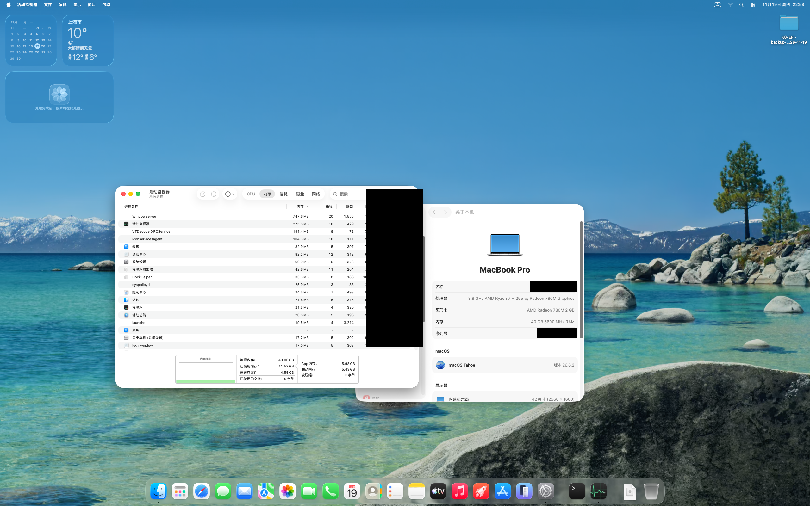

# K8 Mini PC (Ryzen 7 H 255 / Radeon 780M) — macOS Tahoe 26.6.2 Hackintosh

> **阶段一存档（2026-11-22）**：项目阶段性结束，细节按主题拆分到 `docs/`。
> 现状、已知限制、恢复方法与重新启用清单见
> [docs/PHASE1-ARCHIVE-2026-11-22.md](docs/PHASE1-ARCHIVE-2026-11-22.md)。
> 若上游（nullarc / RTL8125 / AWDL）或硬件有突破，再继续更新。

在一台 **KTHIN 科偲 K8** 迷你主机上安装并跑通 macOS Tahoe 的完整记录：OpenCore 引导、安装器 USB 丢中断修复、
nullarc 780M 显卡接管，以及把桌面日常用起来踩过的坑。

> 本仓库是**脱敏后的公开版**：SMBIOS 序列号/MLB/UUID、网卡 MAC、内网地址、用户名均已替换为占位值；
> 第三方二进制（kext、EFI、安装包）不在仓库内，只给出出处与校验值。

## 状态速览（2026-11-22）

| 子系统 | 状态 |
|---|---|
| 引导 | ✅ OpenCore 1.0.8 RELEASE，内置盘独立启动（Timeout=5） |
| GPU / 显示 | ✅ Radeon 780M，Metal 3；HDMI 2560×1600；60 fps；无残影 |
| 帧同步 | ✅ vbl-timing：迟帧均值 ~85 µs，最大 ~1.5 ms |
| 功耗 | ✅ GFXOFF + CPPC：空闲 socket 5–7 W |
| 音频 | ✅ VoodooHDA_BL：耳机/扬声器输出 + 模拟麦克风 |
| 蓝牙 | ✅ AX200 `8087:0029` 可用（键鼠/耳机）；无 Handoff/AirDrop |
| Wi-Fi | ✅ WPA2 可连；WPA3-only 不支持 |
| 有线 | ⚠️ 驱动存在 fq_codel panic 风险，大流量建议走 Wi-Fi |
| USB | ✅ xHCI 走 INTx；⚠️ USB-C 无视频（USB4 无驱动） |
| 容器 | ✅ Kiri + RyzenHV（compose/build）；K8s 未测 |

**已知阻塞（简述）**：RTL8125 `fq_codel` panic、WindowServer `radv` 偶发崩溃、AirDrop 无 AWDL、
USB-C 需 DisplayLink、设置页/墙纸 CPU 偏高。
逐条原因与规避见 [存档文档 §3](docs/PHASE1-ARCHIVE-2026-11-22.md#3-已知限制不要再重复踩)。

## 文档索引

| 文档 | 内容 |
|---|---|
| [docs/PHASE1-ARCHIVE-2026-11-22.md](docs/PHASE1-ARCHIVE-2026-11-22.md) | 存档总览、已知限制、恢复手册、重新启用清单 |
| [docs/build.md](docs/build.md) | 安装 U 盘、EFI 要点、GPU 接管、验收命令（原 §4–5） |
| [docs/pitfalls.md](docs/pitfalls.md) | 三个真正的坑、恢复手段（原 §3、§6） |
| [docs/display-gpu.md](docs/display-gpu.md) | 显示配置、vbl-timing/dbuf、卡顿、WindowServer 崩溃（§7.0–7.3/7.13/7.17） |
| [docs/bluetooth.md](docs/bluetooth.md) | AX200 蓝牙双层修复（§7.4/§7.14） |
| [docs/network.md](docs/network.md) | RTL8125、Wi-Fi WPA3、AirDrop（§7.7/§7.15/§7.16） |
| [docs/usb-xhci.md](docs/usb-xhci.md) | xHCI INTx、USB-C/第二屏（§7.9/§7.11） |
| [docs/audio-power.md](docs/audio-power.md) | 音频与空载功耗（§7.5） |
| [docs/cpu-pm.md](docs/cpu-pm.md) | AMD CPPC / EPP（§7.10） |
| [docs/boot.md](docs/boot.md) | OpenCore 与快速启动（§7.8） |
| [docs/upstream.md](docs/upstream.md) | 参考项目与上游跟进（§7.6/§7.12） |
| [docs/docker-kiri.md](docs/docker-kiri.md) | Docker / Kiri（§11） |
| [docs/evidence.md](docs/evidence.md) | 证据清单（§8） |
| [docs/license.md](docs/license.md) | 脱敏与许可（§9） |
| [docs/hardware-report.md](docs/hardware-report.md) | 硬件报告（Windows 侧 msinfo32/dxdiag 摘要） |
| [docs/k8-install-guide.md](docs/k8-install-guide.md) | 安装指南原文 |
| [docs/minipc-step0-checklist.md](docs/minipc-step0-checklist.md) | 第 0 步 GPU 清单 |

## 硬件与系统

| 部件 | 规格 |
|---|---|
| 机器 | KTHIN 科偲 K8（迷你主机，BIOS 2.09 / AMI 2.22.0059，纯 UEFI） |
| CPU | AMD Ryzen 7 H 255（8C/16T，Zen 4 Hawk Point，80W） |
| 核显 | Radeon 780M，PCI `1002:1900` |
| 内存 | 40 GB DDR5-5600（16+24） |
| 存储 | Lexar NM710 1TB（NVMe，整盘安装 macOS） |
| 网卡 | 2× RTL8125 2.5G 有线；Intel AX200（Wi-Fi/BT） |
| 显示 | HDMI 2560×1600@60（固件 GOP 点亮的单一模式） |
| 系统 | **macOS Tahoe 26.6.2（build 25G83）**，OpenCore 1.0.8 |

---

## 快速开始

1. 装机：按 [docs/build.md](docs/build.md) 做 U 盘与 EFI（注意安装器卡死与启动项两个坑）。
2. 装机前先读 [docs/pitfalls.md](docs/pitfalls.md)。
3. 装完对照 [存档文档](docs/PHASE1-ARCHIVE-2026-11-22.md) 的状态表与恢复手册验收。

## 致谢

- **Acidanthera**：OpenCore、Lilu、VirtualSMC、AMFIPass、RestrictEvents 等
- **Firebat U6C EFI**（`luuumi-dev`）：本机 EFI 的底座
- **`sfyyy/mechrevo-f7bsc-hackintosh`**：同代 7840H 迷你主机参考；`XhciNudge` 行为分析与 Tahoe USB/GPU 经验
- **`bbbbRT`**：`XhciNudge.kext` 原始二进制
- **`izerok/nullarc`**（`hdmi-fb2` 分支）：780M 加速与 fork 版 kext
- **Cobalt64 / nullmoth**：RDNA3 macOS 驱动研究
- **Mieze**：RTL812xLucy；**OpenIntelWireless / laobamac / lshbluesky**：AX200 驱动 fork
